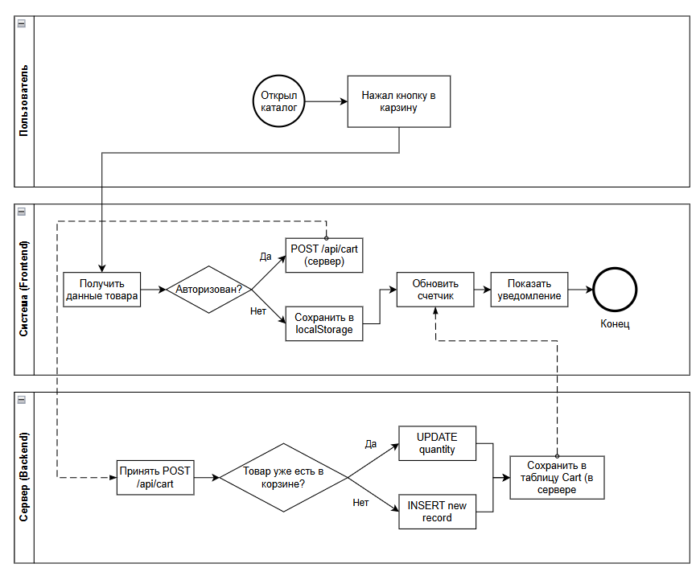
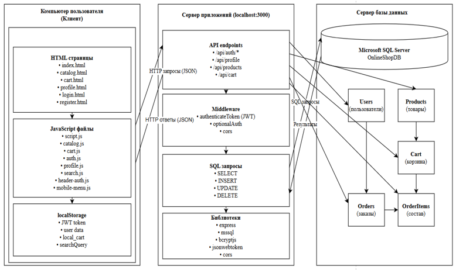
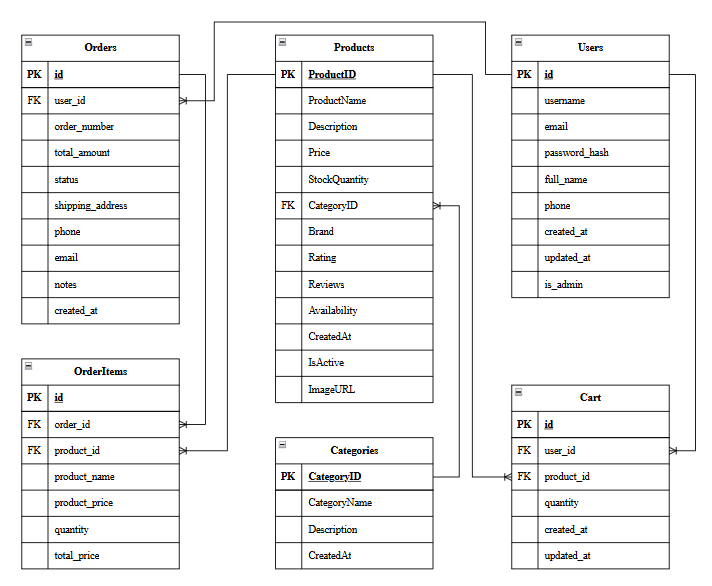

# TechMir — Electronics Store

**Дипломный проект | Full-Stack приложение**  
**Стек:** Node.js + Express + MS SQL Server | **Фронтенд:** Vanilla JS (ES6+)

---

## Обзор

Клиент-серверная система для интернет-торговли электроникой. Сервер раздаёт статику и обрабатывает REST API. Фронтенд реализован на чистом JavaScript без фреймворков. Проект построен с акцентом на безопасность и целостность данных.

---

## Ключевые реализованные механики

### 1. Гибридная корзина с синхронизацией
- **Гости:** товары хранятся в `localStorage`.
- **Авторизованные пользователи:** данные хранятся на сервере (таблица `Cart`).
- **Синхронизация:** при входе гостевые товары автоматически переносятся на сервер через запрос `POST /api/cart`.

**BPMN-диаграмма процесса добавления товара в корзину:**


### 2. Безопасность (уровень Middle)
- Пароли хешируются через `bcryptjs` (10 раундов) — в БД хранятся только хеши.
- Аутентификация через JWT с временем жизни 7 дней.
- Защита маршрутов через middleware `authenticateToken` и `isAdmin`.
- Защита от SQL-инъекций за счёт параметризованных запросов (`mssql.input()`).

### 3. Транзакции при заказах
- При создании заказа запускается `sql.Transaction`.
- Внутри: проверка остатков → создание заказа → списание товаров → очистка корзины.
- При ошибке любого шага — полный откат (`rollback`), остатки не уходят в минус.
- При отмене заказа (`cancelled`) товары возвращаются на склад (в той же транзакции).

### 4. Каскадное удаление аккаунта
- Удаление профиля через `DELETE /api/profile` стирает в одной транзакции: корзину, все заказы, позиции заказов и самого пользователя.  
Это исключает появление «мёртвых» данных и защищает персональную информацию.

---

## Архитектура системы

### Диаграмма развертывания (Deployment Diagram)
На схеме показано, как компоненты системы физически размещаются и взаимодействуют друг с другом.



---

## Модель данных (ER-диаграмма)

База данных спроектирована для интернет-магазина электроники. Основные сущности: пользователи, товары, категории, корзина, заказы и состав заказов.



---

## Эндпоинты (REST API)

Все маршруты начинаются с `/api`.

**Аутентификация**
```
POST /auth/register     — регистрация
POST /auth/login        — вход, выдача JWT
POST /auth/logout       — выход (защищённый)
```

**Профиль** (защищённые)
```
GET  /profile           — данные пользователя
PUT  /profile           — обновить профиль
DELETE /profile         — удалить аккаунт (каскадно)
```

**Товары** (открытые)
```
GET  /products          — каталог
GET  /products/:id      — детали товара
```

**Корзина** (защищённые)
```
GET  /cart              — получить корзину
POST /cart              — добавить товар
PUT  /cart/:cartId      — изменить количество
DELETE /cart/:cartId    — удалить товар
DELETE /cart            — очистить корзину
```

**Заказы** (защищённые)
```
POST /orders            — создать заказ (транзакция)
GET  /orders/my-orders  — история заказов
GET  /orders/:id        — детали заказа
PUT  /orders/:id/cancel — отменить заказ (возврат товаров)
```

**Админ-панель** (защищённые, требуется `is_admin = 1`)
```
GET  /admin/users       — список пользователей
GET  /admin/orders      — все заказы
PUT  /admin/orders/:id/status — изменить статус заказа
GET  /admin/stats       — статистика (заказы, выручка, пользователи, товары)
```

---

## Структура репозитория

```
/
├── backend/
│   ├── server.js          # Бэкенд: БД, роуты, JWT, транзакции
│   ├── package.json       # Зависимости
│   └── package-lock.json
│
├── frontend/
│   ├── index.html
│   ├── catalog.html
│   ├── cart.html
│   ├── login.html
│   ├── register.html
│   ├── profile.html
│   ├── admin.html
│   ├── css/
│   ├── images/
│   └── js/
│       ├── script.js      # Гибридная корзина (Cart)
│       ├── cart.js        # Страница корзины (CartPage)
│       ├── auth.js        # Вход и регистрация
│       ├── logout.js      # Выход
│       ├── admin.js       # Админ-панель
│       ├── profile.js     # Профиль, заказы
│       ├── catalog.js     # Каталог
│       ├── index.js       # Главная страница
│       ├── header-auth.js # Шапка
│       ├── search.js      # Поиск
│       ├── carousel.js    # Карусель
│       ├── mobile-menu.js # Бургер-меню
│       └── mobile-filters.js # Фильтры на мобильных
│
├── diagrams/              # Схемы и диаграммы
│   ├── 01_bpmn_cart.png
│   ├── 02_deployment.png
│   └── 03_er_database.png
│
├── .gitignore
└── README.md
```

---

## Запуск проекта

### 1. Подготовка базы данных
- Установите **Microsoft SQL Server** (подойдёт бесплатная версия Express).
- Создайте новую базу данных `OnlineShopDB`.
- Выполните SQL-скрипт для создания таблиц:  
  `Users`, `Products`, `Categories`, `Cart`, `Orders`, `OrderItems`.

### 2. Настройка окружения (безопасно)
В папке `backend` создайте файл `.env` и укажите ваши параметры подключения:
```env
DB_SERVER=localhost
DB_DATABASE=OnlineShopDB
DB_USER=shop_user
DB_PASSWORD=ваш_реальный_пароль
```
**Никогда не заливайте `.env` в GitHub.** Для этого в корне проекта есть `.gitignore`, который блокирует его публикацию.

### 3. Запуск сервера
```bash
cd backend
npm install
node server.js
```

Откройте браузер и перейдите по адресу:
```
http://localhost:3000
```
